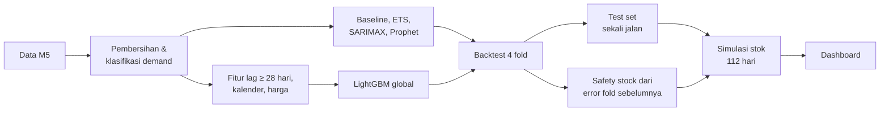
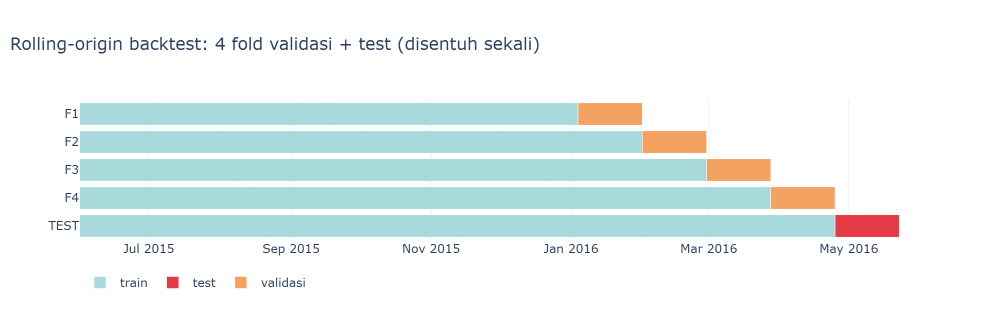
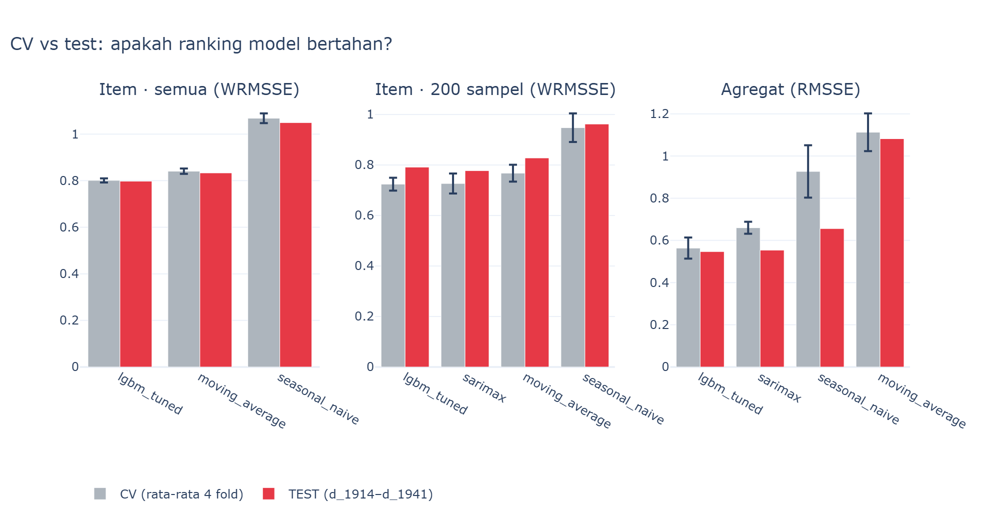
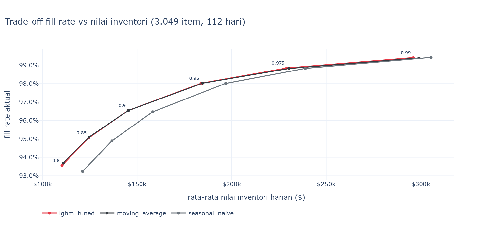

# Forecasting Permintaan & Perencanaan Stok (M5 Walmart)

Memprediksi penjualan harian **3.049 item** di satu toko Walmart untuk **28 hari ke depan**, lalu menguji apakah forecast yang lebih akurat benar-benar menghemat stok.


[](https://m5demandforecasting.streamlit.app/)

> 🚀 **Demo:** [m5demandforecasting.streamlit.app](https://m5demandforecasting.streamlit.app/) (kalau app sedang tidur, klik tombol untuk membangunkannya dan tunggu sebentar)

## Ringkasan hasil

| Pertanyaan | Jawaban |
|---|---|
| Model terbaik? | **LightGBM global.** WRMSSE test **0,798**, 4,2% lebih baik dari Moving Average 28 hari |
| Estimasinya bisa dipercaya? | Skor test masih di dalam rentang CV (**0,801 ± 0,009**). Test set hanya dievaluasi sekali |
| Selalu menang? | **Tidak.** Di sampel 200 item, LightGBM dan SARIMAX bergantian menang |
| Menghemat stok? | **8,3%** lebih hemat dari Seasonal Naive, tetapi **hampir sama** dengan Moving Average (−0,1%) |
| Penentu biaya terbesar? | **Target service level.** Dari 0,95 ke 0,99, nilai stok naik 61% untuk tambahan fill rate 1,4 poin |

Penghematan stok dihitung pada fill rate 97%. Semua angka stok berasal dari simulasi 112 hari.

## Masalah bisnis

Seorang planner di toko **CA_1** memesan barang seminggu sekali. Pesanan terlalu sedikit membuat pelanggan tidak kebagian, sedangkan pesanan terlalu banyak membuat modal tertahan di gudang. Planner butuh tiga hal: perkiraan penjualan, jumlah stok cadangan (*safety stock*), dan daftar kelompok item yang memang sulit diprediksi.

Project ini tidak berhenti di metrik akurasi. Forecast dari setiap model dipakai dalam simulasi stok, lalu dibandingkan dari **berapa modal yang dibutuhkan untuk melayani pelanggan pada tingkat yang sama**.

## Data & scope

| | |
|---|---|
| Sumber | M5 Forecasting - Accuracy ([izin pemakaian](#sumber-data--izin-pemakaian)) |
| Scope | 1 toko (CA_1), 3.049 item, 3 kategori, 7 departemen |
| Periode | 29 Januari 2011 – 22 Mei 2016, harian (±4,8 juta baris) |
| Tantangan utama | 55% baris bernilai nol; 72% item jarang terjual (*intermittent*) |

Setiap item dikelompokkan ke salah satu **kelas demand** (Syntetos–Boylan), berdasarkan seberapa sering terjual dan seberapa bervariasi jumlahnya:

| Kelas | Ciri | Jumlah item | Porsi revenue |
|---|---|---|---|
| smooth | Rutin, jumlahnya stabil | 239 | 24% |
| erratic | Rutin, jumlahnya bervariasi | 83 | 4% |
| intermittent | Jarang terjual | 2.194 | 60% |
| lumpy | Jarang, jumlahnya bervariasi | 533 | 12% |

<sub>Dua item dengan histori terlalu pendek digabung ke intermittent. Porsi revenue dihitung dari 28 hari sebelum test.</sub>

## Pendekatan



### Validasi: rolling-origin backtest

Data time series tidak boleh dibagi acak, karena model akan ikut melihat masa depan. Di sini model dilatih dengan data sampai sebuah tanggal (*cutoff*), lalu diuji pada 28 hari berikutnya. Cutoff digeser empat kali (F1–F4).



Yang dijaga supaya angkanya jujur:

- **Test set dievaluasi satu kali.** Kandidat model dikunci lebih dulu, dan [scriptnya](scripts/final_test.py) menolak dijalankan ulang tanpa alasan tertulis.
- **Anti-leakage diuji otomatis.** Penjualan setelah cutoff diubah, lalu [test](tests/test_features_leakage.py) memastikan semua fitur 28 hari berikutnya tetap sama.
- **Early stopping tidak memakai jendela validasi**, tetapi 28 hari terakhir dari data training.
- **Safety stock hanya dikalibrasi dari fold sebelumnya.**

### Metrik

- **WRMSSE-lite** (utama, level item): error tiap item dibagi error tebakan naive di data training, lalu dibobot revenue 28 hari terakhir. Versi sederhana dari metrik resmi M5.
- **RMSSE** (level agregat): sama, tanpa bobot revenue.
- **WAPE** (total selisih dibagi total penjualan) dan **bias** (negatif = forecast terlalu rendah).

### Model yang dibandingkan

| Model | Cara kerja | Dijalankan di |
|---|---|---|
| Seasonal Naive | Menyalin hari yang sama minggu lalu | Semua level |
| Moving Average 28 (MA28) | Rata-rata 28 hari terakhir | Semua level |
| ETS, SARIMAX, Prophet | Satu model untuk setiap deret | 11 deret agregat + sampel 200 item |
| **LightGBM** (tweedie) | Satu model untuk semua item, 38 fitur, tuning Optuna 30 trial | Semua item; agregat = penjumlahan prediksi item |

Strateginya **direct**: semua fitur penjualan memakai data minimal 28 hari sebelum hari yang diprediksi, jadi satu model bisa memprediksi 28 hari sekaligus.

## Hasil

### Leaderboard (makin kecil makin baik)

**Level item, semua 3.049 item (WRMSSE-lite)**

| Model | CV (4 fold) | Test |
|---|---|---|
| **LightGBM (tuned)** | **0,801 ± 0,009** | **0,798** |
| MA28 | 0,841 ± 0,012 | 0,833 |
| Seasonal Naive | 1,068 ± 0,021 | 1,049 |

**Level item, sampel 200 item (WRMSSE-lite)**

| Model | CV (4 fold) | Test |
|---|---|---|
| LightGBM (tuned) | **0,724 ± 0,026** | 0,792 |
| SARIMAX | 0,727 ± 0,040 | **0,778** |
| ETS | 0,738 ± 0,048 | – |
| MA28 | 0,768 ± 0,033 | 0,828 |
| Prophet | 0,812 ± 0,022 | – |
| Seasonal Naive | 0,948 ± 0,057 | 0,962 |

**Level agregat, 11 deret (RMSSE)**

| Model | CV (4 fold) | Test |
|---|---|---|
| **LightGBM (tuned)** | **0,564 ± 0,050** | **0,547** |
| SARIMAX | 0,660 ± 0,028 | 0,554 |
| Prophet | 0,685 ± 0,066 | – |
| ETS | 0,714 ± 0,082 | – |
| Seasonal Naive | 0,927 ± 0,124 | 0,656 |
| MA28 | 1,113 ± 0,090 | 1,082 |

<sub>Tanda – berarti model tidak dikunci untuk test. Skor CV LightGBM sedikit optimis karena parameternya dipilih memakai fold yang sama. Versi default tanpa tuning lebih baik di agregat CV (0,546), tetapi model final dipilih dari metrik utama.</sub>



### Error per kelas demand (RMSSE, CV, sampel 200 item)

| Model | smooth | erratic | intermittent | lumpy |
|---|---|---|---|---|
| LightGBM | **0,709** | **0,616** | **0,660** | 0,671 |
| SARIMAX | 0,714 | **0,616** | 0,663 | 0,661 |
| ETS | 0,716 | 0,634 | 0,663 | **0,647** |
| MA28 | 0,750 | 0,644 | 0,664 | 0,650 |
| Prophet | 0,766 | 0,719 | 0,751 | 0,714 |
| Seasonal Naive | 0,932 | 0,794 | 0,891 | 0,796 |

Tidak ada model yang menang di semua kelas. Di item lumpy, ETS dan rata-rata bergerak lebih baik dari LightGBM.

### Fitur yang penting

- **Level penjualan terkini** paling menentukan: rata-rata 28 dan 56 hari menyumbang ±60% *gain*.
- **Kalender wajib ada.** Tanpa fitur kalender, error agregat naik 79% dan error item naik 3,1%.
- **Harga hampir tidak berpengaruh** di toko ini (error item +0,4% kalau dibuang).

## Dampak bisnis

Kebijakan yang disimulasikan: stok dicek setiap 7 hari, barang datang 3 hari kemudian, dan permintaan yang tidak terlayani dianggap hilang. Semua model diberi perlakuan yang sama.



Nilai stok rata-rata yang dibutuhkan untuk **fill rate** (persentase permintaan yang terlayani) yang sama:

| Fill rate | LightGBM | MA28 | Seasonal Naive | vs Seasonal Naive | vs MA28 |
|---|---|---|---|---|---|
| 95% | $124,0 ribu | $123,6 ribu | $138,1 ribu | −10,2% | +0,3% |
| 97% | $157,3 ribu | $157,5 ribu | $171,6 ribu | −8,3% | −0,1% |
| 99% | $248,0 ribu | $252,6 ribu | $258,9 ribu | −4,2% | −1,8% |

**Rekomendasi:**

1. **Ganti perencanaan "salin minggu lalu" dengan kebijakan berbasis forecast.** MA28 sudah memberi hampir semua penghematannya. LightGBM layak dipakai kalau akurasi harian dan forecast agregat juga dibutuhkan.
2. **Tentukan dulu service level yang dibutuhkan.** Pengaruhnya ke biaya lebih besar daripada pilihan model.
3. **Uji target yang berbeda per kelas demand** dan kalibrasi ulang safety stock secara berkala. Keduanya belum disimulasikan di sini.

## Pelajaran utama

- **Akurasi lebih baik tidak otomatis berarti stok lebih hemat.** Stok ditentukan oleh error besar dalam 10 hari, bukan rata-rata error harian. Dibanding MA28, LightGBM lebih baik di intermittent, lumpy, dan erratic, tetapi lebih buruk di smooth untuk error jenis ini.
- **Baseline sederhana harus dipilih dengan serius.** Seasonal Naive mudah dikalahkan, sedangkan MA28 tidak.
- **Model statistik cukup untuk sedikit deret.** Di sampel 200 item, SARIMAX setara LightGBM. Keunggulan praktis LightGBM adalah satu model untuk ribuan item, dan totalnya konsisten di semua level.
- **Horizon itu penting.** Di sampel 200 item, ETS dan SARIMAX lebih akurat di minggu pertama, LightGBM di minggu keempat.

## Keterbatasan & pengembangan

| Keterbatasan | Ide lanjutan |
|---|---|
| **Censored demand:** data berisi penjualan, jadi permintaan saat stok kosong tidak tercatat | Estimasi permintaan yang hilang |
| Semua model terlalu rendah di jendela test (LightGBM −6,1%) | Koreksi bias dan kalibrasi ulang berkala |
| LightGBM tidak memakai data terbaru untuk hari-hari awal | Model terpisah per horizon |
| Interval terlalu sempit di test (P90 mencakup 87,6%) | LightGBM kuantil, conformal adaptif |
| Lead time pasti, nilai stok dari harga jual, tanpa minimum order dan kedaluwarsa | Lead time acak, harga pokok, batasan pesanan |
| Satu toko, satu periode test, tanpa uji signifikansi; jendela test ikut dipakai di simulasi | Multi-toko, rekonsiliasi hierarki |

## Dashboard

**Live:** [m5demandforecasting.streamlit.app](https://m5demandforecasting.streamlit.app/)

Lima halaman: Overview, Model Comparison, Forecast Explorer, Inventory Planner, dan Methodology. App hanya membaca hasil yang sudah dihitung (0,12 MB), dan artefaknya sudah ada di repo. Jadi dashboard bisa dijalankan **tanpa mengunduh data M5**:

```powershell
py -3.12 -m venv .venv
.\.venv\Scripts\Activate.ps1
python -m pip install -r app/requirements.txt
python -m streamlit run app/streamlit_app.py
```

## Menjalankan seluruh project

Perintah di bawah untuk Windows PowerShell dan Python 3.12, dijalankan dari root project.

**1. Siapkan environment**

```powershell
py -3.12 -m venv .venv
.\.venv\Scripts\Activate.ps1
python -m pip install --upgrade pip
python -m pip install -r requirements.txt
python -m pip install -e .
python -m ipykernel install --user --name demand-forecasting --display-name "Python (demand-forecasting)"
```

**2. Letakkan data** M5 (file CSV) di `data/raw/`, lihat [cara mendapatkannya](#sumber-data--izin-pemakaian).

**3. Jalankan pipeline**

```powershell
python -m scripts.make_dataset
python -m scripts.classify_demand

# Baseline dan model statistik
python -m scripts.select_sarima_order
foreach ($m in "naive", "seasonal_naive", "moving_average", "ets", "sarimax", "prophet") {
    python -m scripts.run_backtest --model $m --level item
    python -m scripts.run_backtest --model $m --level agg
}

# LightGBM
python -m scripts.build_features
foreach ($m in "lgbm_tweedie", "lgbm_poisson", "lgbm_l2") { python -m scripts.run_backtest --model $m }
python -m scripts.tune_lgbm --objective tweedie
foreach ($m in "lgbm_tuned", "lgbm_no_price", "lgbm_no_calendar") { python -m scripts.run_backtest --model $m }

# Test set (sekali), simulasi stok, artefak dashboard
python -m scripts.build_features --include-test
python -m scripts.final_test --confirm-final-test --rerun-reason "reproduksi di mesin lain"
python -m scripts.run_inventory_sim
python -m scripts.export_app_artifacts
```

Yang paling lama adalah tuning Optuna (±4,7 jam di CPU 16 core). Hasilnya sudah ada di `reports/results/lgbm_best_params.json`, jadi langkah itu boleh dilewati. `final_test` memakai `--rerun-reason` karena repo ini sudah memuat `test_results.csv`; tanpa alasan tertulis, script akan menolak jalan. Langkah ini hanya untuk reproduksi, bukan untuk memilih model.

**4. Jalankan test**

```powershell
python -m pytest -q
```

## Struktur project

```
configs/config.yaml     semua parameter (fold, horizon, lead time, service level)
src/forecasting/        package utama: data, features, validation, models,
                        evaluation, inventory, viz
scripts/                perintah per tahap
notebooks/              01 EDA · 02 model statistik · 03 LightGBM & SHAP
                        04 evaluasi & error analysis · 05 simulasi stok
app/                    dashboard Streamlit dan artefaknya
tests/                  unit test: leakage, backtest, metrik, inventori, dashboard
reports/                tabel hasil dan gambar
```

## Sumber data & izin pemakaian

Project ini memakai dataset kompetisi **M5 Forecasting - Accuracy**, yang diselenggarakan oleh **University of Nicosia** di Kaggle dengan data penjualan **Walmart**. Terima kasih kepada semua pihak yang menyediakannya.

- **Data tidak disertakan di repo ini.** [Aturan kompetisi](https://www.kaggle.com/competitions/m5-forecasting-accuracy/rules) (bagian 7) membatasi pemakaian untuk tujuan non-komersial, riset akademik, dan edukasi, serta tidak mengizinkan data dipublikasikan atau disebarkan ulang.
- **Pemakaian di sini:** pembelajaran dan portofolio pribadi, non-komersial.
- **Yang dipublikasikan:** kode, metrik model, ringkasan agregat, dan grafik. Contoh per item disamarkan (nama generik, hari relatif, dan indeks).

**Cara mendapatkan data:** masuk ke Kaggle, setujui aturan di [halaman kompetisi](https://www.kaggle.com/competitions/m5-forecasting-accuracy), unduh dari tab *Data*, lalu ekstrak file CSV-nya ke `data/raw/`.

Project ini tidak berafiliasi dengan Walmart, University of Nicosia, maupun Kaggle.
